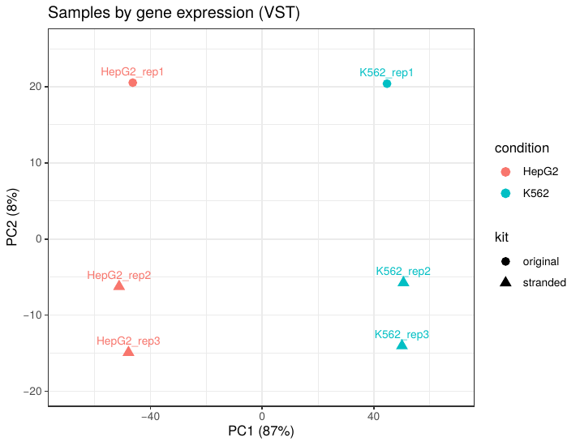
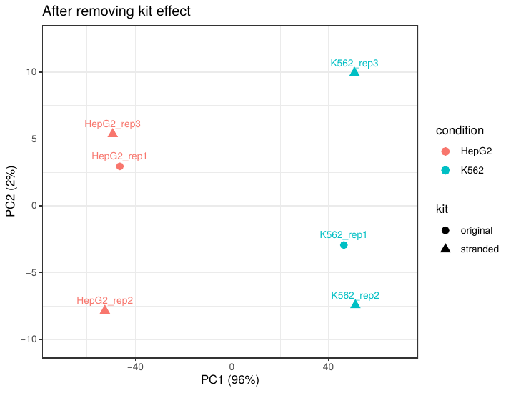

# nanopore-rnaseq-snakemake

[](https://github.com/dlagunasantof/nanopore-rnaseq-snakemake/actions/workflows/ci.yml)
[](https://snakemake.github.io)
[](LICENSE)

A reproducible Snakemake workflow for **Oxford Nanopore long-read RNA-seq**: read QC, alignment to the transcriptome, isoform-level quantification and gene-level differential expression. Every step runs in its own pinned Conda environment, and the workflow is tested automatically on a small synthetic dataset with GitHub Actions.

## Workflow

```
FASTQ ──► seqkit (optional subsampling) ──► NanoPlot (read QC) ───────────────┐
  │                                                                           ▼
  └──► minimap2 -ax map-ont (transcriptome) ──► samtools flagstat ──────► MultiQC report
                     │
                     ▼
                oarfish (EM isoform quantification)
                     │
                     ▼
         transcript / gene count matrices ──► DESeq2 (results, PCA, MA plot)
```

| Step | Tool | Output |
| --- | --- | --- |
| Optional subsampling | seqkit | `results/reads/` |
| Read QC | NanoPlot | `results/qc/nanoplot/` |
| Transcriptome alignment | minimap2 (`-ax map-ont -p 0 -N 10`), samtools | `results/alignments/` |
| Transcript quantification | oarfish | `results/oarfish/` |
| Count matrices | pandas | `results/counts/` |
| Differential expression | DESeq2 | `results/deseq2/` |
| Summary report | MultiQC | `results/multiqc/multiqc_report.html` |

**Design choices**

- Reads are aligned to the **transcriptome**, keeping secondary alignments, so that oarfish can resolve reads compatible with several isoforms using an expectation–maximisation algorithm.
- Alignments on **both strands** are kept. PCR-cDNA reads come in both orientations (unlike direct RNA reads); quantifiers designed for direct RNA, such as NanoCount, discard reverse-strand alignments and would lose about half of the reads. The synthetic test data include reverse-complemented reads to guard against this.
- Transcript counts are summed per gene (using the GTF) for DESeq2; transcript-level counts and counts per million (CPM) are kept for isoform analyses.
- DESeq2 runs only when the sample sheet has at least two conditions with two or more replicates each.
- Technical covariates such as the library kit or sequencing batch can be added to the model (`deseq2.covariates` in the config, e.g. `["kit"]` → `design ~ kit + condition`). The PCA report then shows the samples before and after removing that effect.

## Quick start

### 1. Install Snakemake

```bash
conda create -n snakemake -c conda-forge -c bioconda "snakemake>=8"
conda activate snakemake
```

### 2. Test on the bundled synthetic data (about 5 minutes the first time, mostly creating environments)

```bash
git clone https://github.com/dlagunasantof/nanopore-rnaseq-snakemake.git
cd nanopore-rnaseq-snakemake
snakemake -s workflow/Snakefile --directory .test --sdm conda --cores 2
```

The test data (`.test/`) contain 6 samples × 1,000 simulated nanopore-like reads from 40 transcripts (half of them reverse-complemented, as in unstranded cDNA); three genes are up-regulated and two down-regulated in `treated`. Regenerate them with `python .test/make_test_data.py` from inside `.test/`.

### 3. Run on real data

**Reference** (GENCODE human transcriptome + annotation):

```bash
bash scripts/download_reference.sh 47   # check the latest release at gencodegenes.org
```

**Reads**: the example design uses public data from the [Singapore Nanopore Expression Project (SG-NEx)](https://registry.opendata.aws/sgnex/), PCR-cDNA runs of two cell lines (HepG2, K562) in three biological replicates each. SG-NEx sequenced these samples with two PCR-cDNA kits, so each cell line uses one run of the original kit and two of the stranded kit; this balanced design lets DESeq2 separate the kit effect from the cell-line effect. The exact runs are listed in `config/samples.tsv`.

```bash
conda install -c conda-forge awscli
bash scripts/download_sgnex.sh list HepG2 cDNA          # find the FASTQ files
bash scripts/download_sgnex.sh get <s3-path> data/HepG2_rep1.fastq.gz
```

Then edit `config/samples.tsv` (columns: `sample`, `condition`, `fastq`) and `config/config.yaml`, and run:

```bash
snakemake -s workflow/Snakefile --sdm conda --cores 8
```

By default each sample is subsampled to 500,000 reads (`subsample_reads` in the config) so the full run fits on a modest server; set it to `0` to use all reads.

### Running on a cluster

An example SLURM profile is provided in `profiles/slurm/` (requires `snakemake-executor-plugin-slurm`; set your partition and account first):

```bash
snakemake -s workflow/Snakefile --profile profiles/slurm
```

## Repository structure

```
├── config/                 config.yaml, samples.tsv
├── workflow/
│   ├── Snakefile
│   ├── rules/              one .smk file per stage
│   ├── envs/               pinned Conda environments
│   └── scripts/            reference preparation, count merging, DESeq2
├── profiles/slurm/         example cluster profile
├── scripts/                data download helpers
├── docs/figures/           figures shown in this README
├── .test/                  synthetic test dataset and config
└── .github/workflows/      continuous integration
```

## Results on SG-NEx data

**K562 (chronic myeloid leukaemia) vs HepG2 (hepatocellular carcinoma)**, PCR-cDNA, 3 biological replicates per cell line, 1,000,000 reads per sample, DESeq2 design `~ kit + condition`. The full run took about 70 minutes on a 16-core server with `--cores 8`.

**1,899 genes are differentially expressed** (adjusted p < 0.05). Marker genes behave as expected for each cell type:

| Gene | Lineage | log2 fold change (K562 / HepG2) | Adjusted p |
| --- | --- | --- | --- |
| HBG2 | Erythroid (fetal haemoglobin) | +14.4 | 3.1 × 10⁻²⁶ |
| HBG1 | Erythroid (fetal haemoglobin) | +14.0 | 2.6 × 10⁻²⁵ |
| GATA1 | Erythroid transcription factor | +9.0 | 1.2 × 10⁻¹⁰ |
| ALB | Hepatocyte (albumin) | −13.3 | 9.7 × 10⁻²³ |
| APOA1 | Hepatocyte (apolipoprotein A-I) | −12.9 | 9.8 × 10⁻²² |
| AFP | Fetal liver (alpha-fetoprotein) | −9.9 | 9.3 × 10⁻²⁰ |

**Samples separate by cell line; a smaller kit effect is removed by the model.** Cell line explains 87% of the variance (PC1) and the library kit 8% (PC2). After removing the kit effect, PC1 explains 96% and replicates group by cell line only.

| As measured | After removing the kit effect |
| --- | --- |
|  |  |

**Per-sample metrics**

| Sample | Kit | Median read length (nt) | Reads aligned | Reads quantified by oarfish | Reads kept by NanoCount (v1) |
| --- | --- | --- | --- | --- | --- |
| HepG2_rep1 | original | 721 | 84.9% | 848,863 | 264,892 |
| HepG2_rep2 | stranded | 586 | 59.2% | 592,149 | 388,480 |
| HepG2_rep3 | stranded | 304 | 47.7% | 477,002 | 241,732 |
| K562_rep1 | original | 846 | 86.4% | 863,741 | 256,432 |
| K562_rep2 | stranded | 377 | 47.9% | 478,730 | 307,494 |
| K562_rep3 | stranded | 239 | 18.6% | 185,506 | 44,294 |

### What the first run taught us

The first version of the workflow found only **483** differentially expressed genes, and the PCA showed a strong second axis (18% of the variance) that separated samples by library kit rather than by biology. Two issues explained it:

1. **The quantifier did not fit the protocol.** NanoCount was designed for direct RNA, where every read has the same orientation, and it always discards alignments to the reverse strand. PCR-cDNA reads come in both orientations, so NanoCount kept only about 30% of the aligned reads in the original-kit samples and 51–66% in most stranded-kit samples. Because the loss depended on the kit, it inflated the kit effect. Replacing NanoCount with **oarfish**, which keeps both strands, recovered nearly all aligned reads. The synthetic test data now include reverse-complemented reads so that continuous integration catches this kind of error.
2. **A real technical batch effect.** SG-NEx sequenced these cell lines with two PCR-cDNA kits that differ in read length and mapping rate. The samples were chosen so that each cell line has one original-kit and two stranded-kit runs; this balanced design lets DESeq2 estimate the kit effect (`~ kit + condition`) instead of confusing it with the difference between cell lines.

Together, the two changes raised the number of differentially expressed genes from **483 to 1,899**.

**Known limitation:** stranded-kit samples have shorter reads and lower mapping rates, and K562_rep3 aligns only 18.6% of its reads. It still groups with the other K562 replicates. Orienting and trimming reads with a cDNA preprocessing tool such as pychopper before alignment is a natural next improvement.

## Data and tools

- SG-NEx: Chen Y. *et al.* A systematic benchmark of Nanopore long-read RNA sequencing for transcript-level analysis in human cell lines. *Nature Methods* 22, 801–812 (2025).
- [minimap2](https://github.com/lh3/minimap2) · [samtools](https://github.com/samtools/samtools) · [oarfish](https://github.com/COMBINE-lab/oarfish) · [NanoPlot](https://github.com/wdecoster/NanoPlot) · [seqkit](https://github.com/shenwei356/seqkit) · [DESeq2](https://bioconductor.org/packages/DESeq2) · [MultiQC](https://multiqc.info) · [Snakemake](https://snakemake.github.io)

## Author

Daniela Laguna Santofimio · [GitHub](https://github.com/dlagunasantof) · [LinkedIn](https://linkedin.com/in/daniela-laguna-santofimio)
